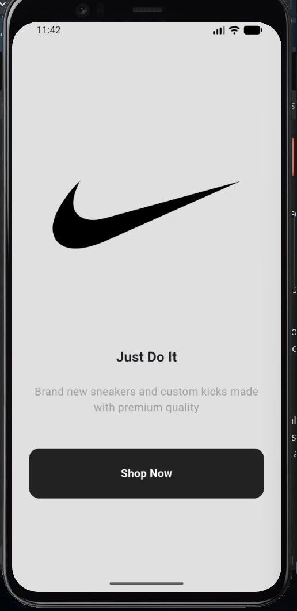
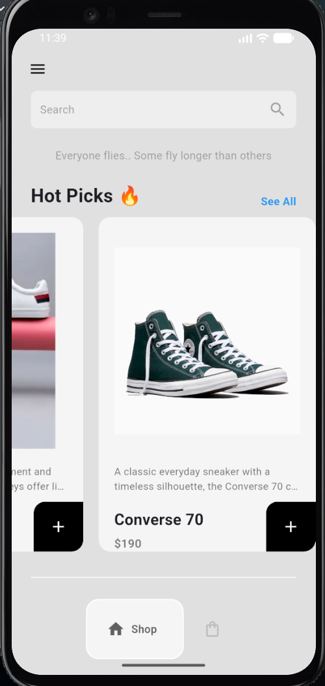
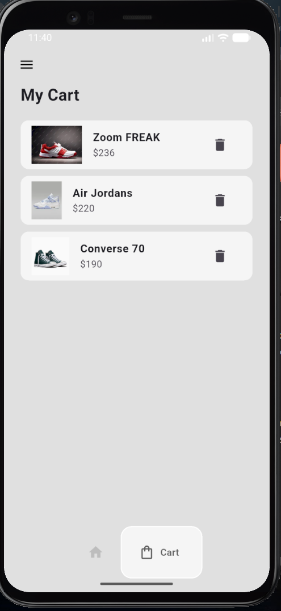
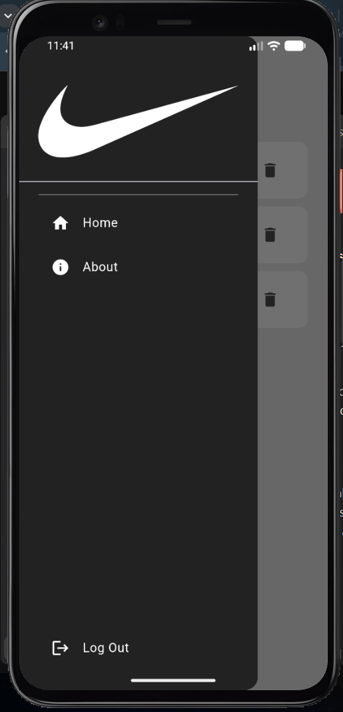
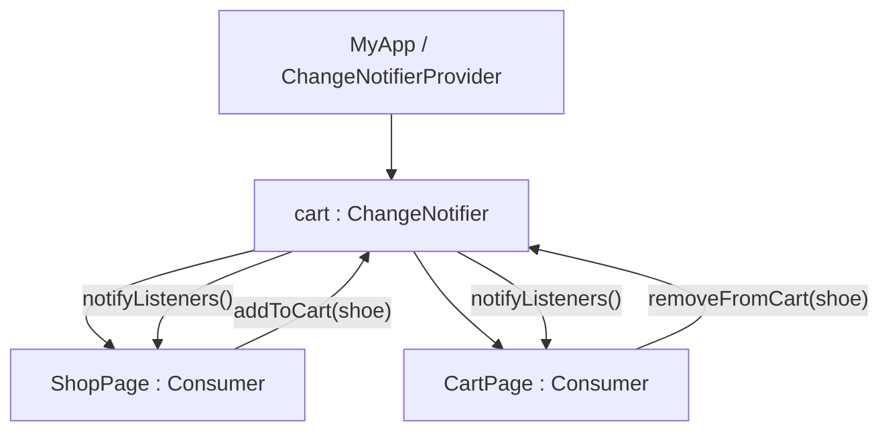

<div align="center">

  

  # 👟 Sneaker Vault - Nike E-Commerce App

  **A modern, minimalist, and responsive sneaker shopping application built with Flutter & Provider.**

  <p align="center">
    <a href="#-key-features">Key Features</a> •
    <a href="#-tech-stack">Tech Stack</a> •
    <a href="#-project-structure">Project Structure</a> •
    <a href="#-getting-started">Getting Started</a> •
    <a href="#-state-management">State Management</a> •
    <a href="#-screenshots">Screenshots</a>
  </p>

  <!-- Badges -->
  <p align="center">
    
    
    
    
    
  </p>

</div>

---

## 📖 Overview

**Sneaker Vault** is a beautifully crafted mobile shopping experience built using Flutter. Designed with a sleek, minimalist aesthetic inspired by the Nike brand, it showcases modern mobile UI/UX design patterns, seamless page transitions, responsive layout structure, and robust reactive state management powered by the Provider package.

---

## ✨ Key Features

- ⚡ **Minimalist & Modern UI**: Tailored with Nike's signature monochrome aesthetic (`grey-300` background and high-contrast dark accents).
- 🏷️ **Intro / Onboarding Screen**: Elegant welcome screen featuring branded typography, tagline, and smooth transition to the storefront.
- 🛍️ **Interactive Product Catalog**:
  - Horizontal card carousel showcasing "Hot Picks 🔥" (Air Jordans, Zoom FREAK, KD Treys, Converse 70).
  - Detailed product cards displaying sneaker name, pricing, high-resolution shoe renders, and description.
  - Quick "Add to Cart" action with instant modal confirmation.
- 🛒 **Dynamic Cart Management**:
  - Real-time reactive cart updates powered by Provider (`ChangeNotifier`).
  - View items added to the cart with thumbnail, model title, and price.
  - Delete / remove items from the cart seamlessly with immediate UI reflection.
- 🧭 **Sleek Navigation**:
  - Floating bottom navigation bar powered by [`google_nav_bar`](https://pub.dev/packages/google_nav_bar).
  - Custom branded side navigation drawer with navigation items (Home, About, Logout).
- 🔍 **Search Bar & Badges**: Clean mock search bar and curated category labels.

---

## 📸 Screenshots & UI Preview

| Intro Screen | Shop Screen | Cart Screen | Navigation Drawer |
|:---:|:---:|:---:|:---:|
|  |  |  |  |

---

## 🛠️ Tech Stack & Dependencies

| Tool / Package | Version | Purpose |
| :--- | :--- | :--- |
| **[Flutter SDK](https://flutter.dev)** | `>= 3.13.2` | Core cross-platform UI framework |
| **[Dart](https://dart.dev)** | `>= 3.1.0` | Client-optimized programming language |
| **[`provider`](https://pub.dev/packages/provider)** | `^6.1.5+1` | Reactive application state management |
| **[`google_nav_bar`](https://pub.dev/packages/google_nav_bar)** | `^5.0.6` | Modern floating tab navigation bar |
| **[`cupertino_icons`](https://pub.dev/packages/cupertino_icons)** | `^1.0.8` | iOS styled iconography assets |

---

## 📁 Project Structure

```text
ecommerce/
├── android/                   # Android native configuration
├── ios/                       # iOS native configuration
├── assets/ (lib/images/)      # Sneaker images & brand assets
│   ├── Jordan.png
│   ├── KdTreys.png
│   ├── ZoomFreak.png
│   ├── converse.png
│   └── nike1.png
├── lib/
│   ├── components/            # Reusable UI components
│   │   ├── bottom_nav_bar.dart# Google Nav Bar implementation
│   │   ├── cart_items.dart    # Individual item tile inside cart
│   │   └── shoe_tile.dart     # Sneaker card tile in store catalog
│   ├── model/                 # Data models & business logic
│   │   ├── cart.dart          # Cart state provider (ChangeNotifier)
│   │   └── shoe.dart          # Shoe data entity
│   ├── pages/                 # Application views / screens
│   │   ├── HomePage.dart      # Main scaffold with drawer & bottom bar
│   │   ├── cart_page.dart     # Cart summary and item removal
│   │   ├── intropage.dart     # Splash / welcome landing page
│   │   └── shop_page.dart     # Store catalog & featured sneakers
│   └── main.dart              # App entry point & provider registration
├── pubspec.yaml               # Dependencies & assets configuration
└── README.md                  # Project documentation
```

---

## ⚙️ Architecture & State Management

The application utilizes the **Provider** pattern for simple, predictable, and reactive state management:



- **`cart` Model (`lib/model/cart.dart`)**:
  - Maintains `shoeShop` (catalog of available sneakers).
  - Maintains `userCart` (list of user-selected items).
  - Exposes methods `addToCart(Shoe)` and `removeFromCart(Shoe)` which invoke `notifyListeners()`.
- **UI Consumers**:
  - `ShopPage` and `CartPage` wrap their view hierarchy in `Consumer<cart>` to efficiently rebuild only the widgets that depend on cart state changes.

---

## 🚀 Getting Started

### Prerequisites

Ensure you have the following installed on your machine:
- [Flutter SDK](https://docs.flutter.dev/get-started/install) (`>= 3.13.2`)
- [Dart SDK](https://dart.dev/get-dart)
- Android Studio / VS Code with Flutter and Dart extensions
- An active Android Emulator, iOS Simulator, or connected physical device

### Installation & Run

1. **Clone the repository:**
   ```bash
   git clone https://github.com/prem70198/sneaker-vault.git
   cd sneaker-vault
   ```

2. **Install project dependencies:**
   ```bash
   flutter pub get
   ```

3. **Verify Flutter setup:**
   ```bash
   flutter doctor
   ```

4. **Launch the application:**
   ```bash
   flutter run
   ```

---

## 📤 Pushing to GitHub

If you haven't initialized your Git repository yet, follow these steps to push your project to GitHub:

```bash
# 1. Initialize git in your project directory
git init

# 2. Stage all project files
git add .

# 3. Create your initial commit
git commit -m "feat: initial commit - Sneaker Vault e-commerce app"

# 4. Set the default branch to main
git branch -M main

# 5. Link your remote GitHub repository
git remote add origin https://github.com/prem70198/sneaker-vault.git

# 6. Push your code to GitHub
git push -u origin main
```

---

## 🤝 Contributing

Contributions, issues, and feature requests are welcome!

1. Fork the Project (`https://github.com/prem70198/sneaker-vault/fork`)
2. Create your Feature Branch (`git checkout -b feature/AmazingFeature`)
3. Commit your Changes (`git commit -m 'feat: Add some AmazingFeature'`)
4. Push to the Branch (`git push origin feature/AmazingFeature`)
5. Open a Pull Request

---

## 📄 License

This project is licensed under the MIT License - see the [LICENSE](LICENSE) file for details.

---

<div align="center">
  <sub>Built with ❤️ using <a href="https://flutter.dev">Flutter</a></sub>
</div>
